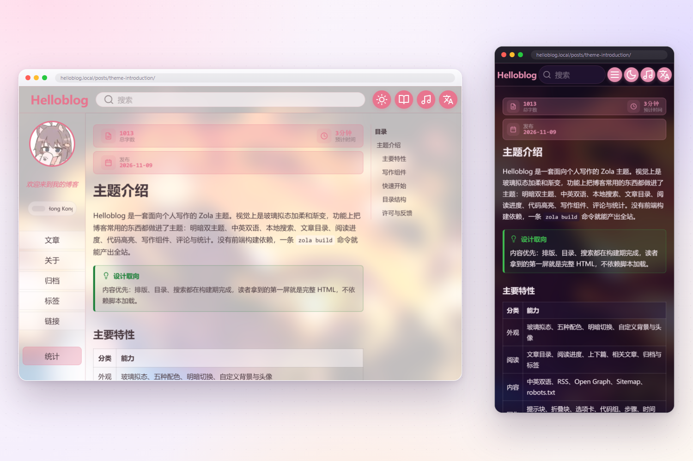

# helloblog

English | [简体中文](README.zh-CN.md)



A glassmorphism personal blog theme for Zola — bilingual content, light/dark modes, local search, and a rich set of Markdown writing components.

**Demo:** https://helloblog.pages.dev/

Articles and the configuration guide live on the demo site: start with **Theme Introduction**, then follow **Configuration Guide** to set up your own site.

## Features

- Glassmorphism UI, five color presets, light/dark mode, custom background and avatar
- Bilingual (Chinese / English) with a translation-aware language switcher
- Local search without a backend, plus archive and tag pages
- Article table of contents, reading progress, related posts, previous/next links
- Markdown writing components: tip / warning / danger / info, tabs, steps, code groups, details, timeline, flow, file tree, diff, console, mermaid, Q&A, compare, quote cards
- giscus comments, Busuanzi analytics, music player
- SEO: canonical, hreflang, Open Graph / Twitter cards, JSON-LD, Atom feed, sitemap, robots.txt
- No Node.js needed — one `zola build` produces the whole site

## Requirements

Zola v0.23.6 or later.

## Install

```bash
git submodule add <repo-url> themes/helloblog
```

```toml
theme = "helloblog"

taxonomies = [{ name = "tags" }]
generate_feeds = true
```

Also copy the `[translations]` and `[languages]` sections and `data/link.json` from this repository into your own project — Zola only merges the theme's `[extra]`, so UI strings and the links page must live in your site. Every option under `[extra]` already has a default in `theme.toml`; override only what you need.

See the **Configuration Guide** on the demo site for the rest.

## License

MIT
