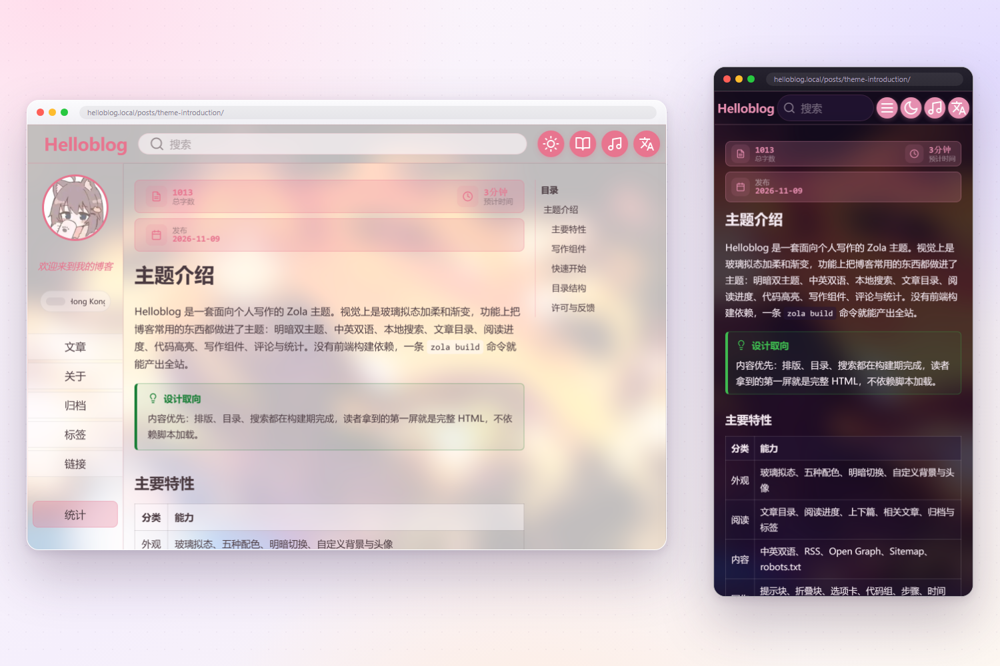

# helloblog

[English](README.md) | 简体中文



一个玻璃拟态风格的 Zola 个人博客主题，支持中英双语、明暗主题、本地搜索，以及一整套 Markdown 写作组件。

**示例站点：** https://helloblog.pages.dev/

示例站点里有《主题介绍》和《配置指南》两篇文章，先看主题介绍，再照着配置指南搭自己的站点。

## 功能

- 玻璃拟态界面，五种配色，明暗切换，自定义背景与头像
- 中英双语，切换按钮自动匹配当前页面的译文
- 无需后端的本地搜索，另有归档页与标签页
- 文章目录、阅读进度、相关文章、上下篇导航
- Markdown 写作组件：提示 / 警告 / 危险 / 信息、选项卡、步骤、代码组、折叠块、时间线、流程图、文件树、diff、终端、mermaid、问答、对比、引用卡
- giscus 评论、不蒜子统计、音乐播放器
- SEO：canonical、hreflang、Open Graph / Twitter 卡片、JSON-LD、Atom、Sitemap、robots.txt
- 不需要 Node.js，一条 `zola build` 产出整站

## 环境要求

Zola v0.23.6 及以上。

## 安装

```bash
git submodule add <repo-url> themes/helloblog
```

```toml
theme = "helloblog"

taxonomies = [{ name = "tags" }]
generate_feeds = true
```

还需要把本仓库的 `[translations]`、`[languages]` 两段以及 `data/link.json` 复制到自己的站点 —— Zola 只合并主题的 `[extra]`，界面文案与友链数据必须放在站点里。`[extra]` 下的所有配置项在 `theme.toml` 中已有默认值，按需覆盖即可。

其余配置见示例站点的《配置指南》。

## 许可

MIT
